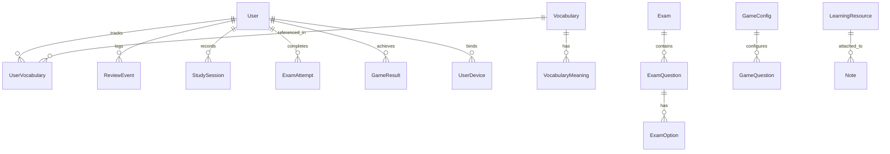
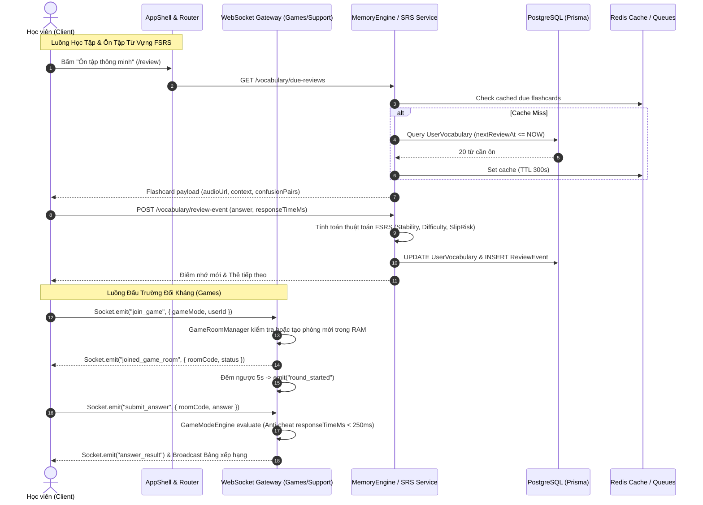
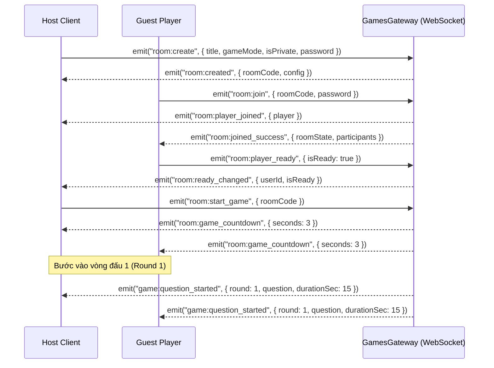
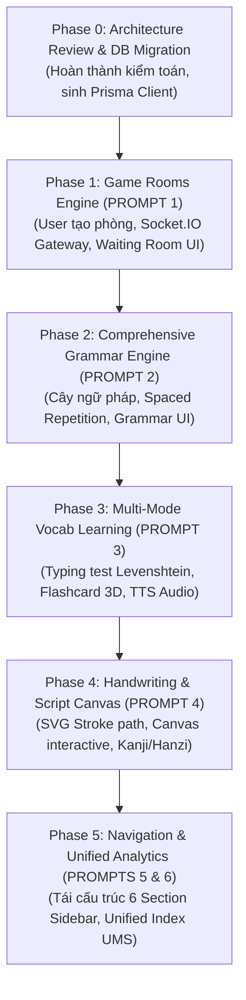

# VOCABFLOW — KIẾN TRÚC HỆ THỐNG & KẾ HOẠCH NÂNG CẤP TOÀN DIỆN (MASTER UPGRADE ARCHITECTURE ANALYSIS)

> **Tài liệu thẩm định kỹ thuật và thiết kế kiến trúc chuẩn bị triển khai**  
> **Dự án:** VocabFlow Language Learning Ecosystem  
> **Mã tài liệu:** `VF-ARCH-2026-v2.1`  
> **Trạng thái:** Hoàn thành thẩm định Codebase (Ready for Implementation Phase 1)  
> **Căn cứ:** Master Upgrade Pack (Prompts 0 -> 7), `AGENTS.md`, Codebase Audit ngày 30/10/2026  

---

## MỤC LỤC TỔNG QUAN

1. [Kiến Trúc Hiện Tại (Current System Architecture)](#1-kiến-trúc-hiện-tại-current-system-architecture)
2. [Database Hiện Tại (Current Database Schema & Domain Map)](#2-database-hiện-tại-current-database-schema--domain-map)
3. [Luồng Dữ Liệu Thực Tế (End-to-End Data Flow Analysis)](#3-luồng-dữ-liệu-thực-tế-end-to-end-data-flow-analysis)
4. [Các Module Có Thể Tái Sử Dụng (Reusable Module Inventory)](#4-các-module-có-thể-tái-sử-dụng-reusable-module-inventory)
5. [Các Vấn Đề Kỹ Thuật Hiện Hữu (Technical Debt & Architectural Bottlenecks)](#5-các-vấn-đề-kỹ-thuật-hiện-hữu-technical-debt--architectural-bottlenecks)
6. [Những Thay Đổi Cần Thực Hiện Cho Prompts 1 -> 6 (Target Architectural Delta)](#6-những-thay-đổi-cần-thực-hiện-cho-prompts-1---6-target-architectural-delta)
7. [Database Migration Dự Kiến (Proposed Prisma Schema & DDL)](#7-database-migration-dự-kiến-proposed-prisma-schema--ddl)
8. [API & WebSocket Contracts Dự Kiến (RESTful & Realtime Specification)](#8-api--websocket-contracts-dự-kiến-restful--realtime-specification)
9. [Thứ Tự & Lộ Trình Triển Khai (Staged Execution Roadmap)](#9-thứ-tự--lộ-trình-triển-khai-staged-execution-roadmap)
10. [Rủi Ro & Phương Án Hạn Chế (Risk Assessment & Mitigation Matrix)](#10-rủi-ro--phương-án-hạn-chế-risk-assessment--mitigation-matrix)

---

## 1. KIẾN TRÚC HIỆN TẠI (CURRENT SYSTEM ARCHITECTURE)

### 1.1. Mô hình Monorepo & Workspaces

Hệ thống VocabFlow được cấu hình theo mô hình Monorepo sử dụng `npm workspaces`:

```
c:\Users\manhd\Downloads\TOEIC-Flashcard-1
├── apps/
│   ├── api/                   # Backend chính (NestJS 10, Prisma 5.14, Port 4000)
│   ├── web/                   # Web App học viên & cổng chính (React 18, Vite 5, Tailwind 3.4, Port 3000)
│   ├── student/               # Portal chuyên biệt cho học viên TOEIC nâng cao
│   ├── kid/                   # Ứng dụng tiếng Anh mầm non/tiểu học (Game-based)
│   ├── admin/                 # Admin Dashboard quản trị nội dung & tài chính
│   └── landing/               # Trang giới thiệu chuyển đổi cao (Marketing Landing)
├── services/
│   ├── app-api/               # Microservice phụ trợ ứng dụng di động
│   ├── admin-api/             # Microservice phụ trợ nghiệp vụ Admin
│   └── kid-api/               # Microservice backend học liệu trẻ em
└── packages/
    └── shared/                # Types dùng chung, JWT payload, Enums, UI Component (@vocabflow/shared)
```

### 1.2. Backend Tech Stack (`apps/api`)
- **Runtime & Framework:** Node.js v20+, NestJS v10 (TypeScript).
- **ORM & Database:** Prisma ORM 5.14.0 kết nối PostgreSQL 16 qua Connection Pooling.
- **In-Memory Cache & Session:** Redis 7 (sử dụng `ioredis` và custom `RedisCacheService`).
- **Message Broker & Queue:** RabbitMQ (quản lý hàng đợi Matchmaking đấu trường và thông báo nền qua `AmqpConnection`).
- **Realtime Infrastructure:** Socket.IO v4 tích hợp qua NestJS `@WebSocketGateway()` (`apps/api/src/modules/games/games.gateway.ts` và CSKH gateway).
- **AI Integration:** OpenAI GPT-4o-mini & Google Gemini SDK (hỗ trợ giải thích ngữ pháp, AI Tutor, phát hiện lỗi phát âm).

### 1.3. Frontend Tech Stack (`apps/web`)
- **Framework & Build tool:** React 18.3, Vite 5, TypeScript 5.4.
- **Styling & UI:** Tailwind CSS 3.4, Lucide React Icons, Glassmorphism design tokens.
- **Routing:** React Router DOM v6 với Code-Splitting cấp route qua `React.lazy` và `Suspense`.
- **State Management:** React Context API (`AuthContext`, `LearningContext`, `I18nContext`), LocalStorage persistent state cache.
- **Realtime Client:** `socket.io-client` v4 kết nối gateway cổng 4000 với cơ chế tự động reconnect và latency ping-pong.

---

## 2. DATABASE HIỆN TẠI (CURRENT DATABASE SCHEMA & DOMAIN MAP)

Codebase hiện sở hữu **75 Prisma Models** và **32 Enums** định nghĩa trong `apps/api/prisma/schema.prisma` (1.511 dòng mã). Các domain nghiệp vụ cốt lõi được phân bổ như sau:



### 2.1. Bảng Dữ Liệu Đang Có & Phân Vùng Nghiệp Vụ

| Phân hệ (Domain) | Các Models Hiện Hữu | Mục đích & Đặc thù hiện tại |
| :--- | :--- | :--- |
| **User & Device Security** | `User`, `UserProfile`, `UserDevice`, `UserSession`, `UserEncryptionKey`, `DeviceRiskEvent`, `DeviceLogoutOtp`, `AdminSecurity` | Bảo mật tài khoản, E2EE key exchange, giới hạn tối đa 3 thiết bị đồng thời theo `DeviceSecurityService`. |
| **Vocabulary & Spaced Repetition** | `Vocabulary`, `VocabularyMeaning`, `ExampleSentence`, `WordRelation`, `VocabularyTopic`, `VocabularyTopicItem`, `UserVocabulary`, `ReviewEvent`, `StudySession`, `VocabularyConfusionPair`, `WordJourneyEvent` | Lưu từ vựng, mối quan hệ từ, nghĩa theo ngữ cảnh, lịch sử ôn tập FSRS/SM-2, chỉ số Memory X-Ray (stability, difficulty, recall probability). |
| **Exams & Question Bank** | `Exam`, `ExamQuestion`, `ExamOption`, `ExamLike`, `ExamDislike`, `ExamComment`, `ExamSaved`, `ExamAttempt`, `ExamAnswer`, `CustomQuiz`, `CustomQuizAttempt` | Ngân hàng đề thi TOEIC/IELTS, câu hỏi trắc nghiệm, lời giải chi tiết, kết quả thi và phân tích câu sai. |
| **Knowledge Base & Notes** | `LearningResource`, `Note`, `NoteCategory`, `CommunityTopic`, `CommunityPost`, `CommunityComment` | Bài giảng Markdown, ghi chép cá nhân với phím tắt Alt+N, diễn đàn chia sẻ kiến thức cộng đồng. |
| **Games & Battles (Hiện tại)** | `GameConfig`, `GameQuestion`, `GameResult` | Cấu hình giải đấu hàng ngày (20:00), ngân hàng câu hỏi phản xạ 8 modes, lưu bảng điểm lịch sử `GameResult`. |
| **Billing & Subscriptions** | `Plan`, `PaymentOrder`, `Subscription`, `EntitlementUsage` | Gói Pro/VIP/Plus, phân quyền tính năng và giới hạn hạn ngạch AI. |

### 2.2. Điểm Khuyết Thiếu Trọng Yếu Trong Database Hiện Tại
1. **Thiếu Bảng Phòng Đấu Do User Tự Tạo (PROMPT 1):** Hiện chỉ có `GameConfig` cho hệ thống và `GameResult` cho lịch sử. Toàn bộ logic phòng đấu hiện nằm trong RAM (`GameRoomManager.rooms: Map<string, GameRoom>`). Chưa có bảng lưu cấu hình phòng cá nhân, danh sách phòng mở, lời mời, mật khẩu bảo vệ hay trạng thái phòng.
2. **Thiếu Hệ Thống Model Ngữ Pháp Chuyên Biệt (PROMPT 2):** Ngữ pháp hiện đang bị lưu phân tán dạng chuỗi tag `grammarType` trong `ExamQuestion` hoặc dạng bài viết tự do trong `LearningResource`. Chưa có bảng phân cấp: Ngữ pháp -> Chủ đề -> Quy tắc -> Cấu trúc -> Câu ví dụ -> Tiến trình thông thạo ngữ pháp của người học.
3. **Thiếu Hệ Thống Bộ Chữ & Tập Viết (PROMPT 4):** Chưa có cấu trúc bảng cho `Script` (Hiragana, Katakana, Kanji, Hanzi, Hangul), `CharacterData` (thứ tự nét SVG, số nét, âm đọc On/Kun/Pinyin), và `UserCharacterProgress`.
4. **Thiếu Bảng Chỉ Số Tiến Trình Hợp Nhất (PROMPT 6):** Tiến trình hiện tại tính toán rời rạc qua từng bảng riêng (`UserVocabulary.masteryScore`, `ExamAttempt.score`, `GameResult.score`), thiếu bảng ghi nhận `UserDomainMasterySnapshot` hoặc `SmartProgressSummary` để vẽ Forgetting Curve và đưa ra gợi ý lộ trình thông minh.

---

## 3. LUỒNG DỮ LIỆU THỰC TẾ (END-TO-END DATA FLOW ANALYSIS)



---

## 4. CÁC MODULE CÓ THỂ TÁI SỬ DỤNG (REUSABLE MODULE INVENTORY)

| Phân hệ nguồn | File / Component | Khả năng tái sử dụng cho Master Pack |
| :--- | :--- | :--- |
| **Realtime Engine** | `apps/api/src/modules/games/games.gateway.ts` | **Rất cao (90%):** Tái sử dụng toàn bộ kiến trúc kết nối Socket.IO, Ping-pong Latency Diagnostic (`ping_latency`), Server-authoritative answer submission, và cơ chế phát hiện chống gian lận (Anti-cheat response time < 250ms). |
| **Game Mode Evaluators** | `apps/api/src/modules/games/game-modes.ts` & `game-mode.interface.ts` | **Rất cao (95%):** Đã hoàn thiện 8 Game Engines với thuật toán chấm điểm độ chính xác (`accuracy`), thưởng chuỗi (`streakBonus`), thưởng tốc độ (`speedBonus`). Chỉ cần mở rộng thêm adapter lấy câu hỏi tùy chỉnh. |
| **Spaced Repetition** | `apps/api/src/modules/vocabulary/memory-engine.service.ts` | **Rất cao (85%):** Thuật toán tính toán `recognitionScore`, `recallScore`, `contextScore`, `productionScore`, `slipRisk` (nguy cơ quên) và Vocabulary X-Ray đã được viết rất hoàn chỉnh. Có thể dùng chung nguyên lý này cho Ngữ pháp và Luyện viết. |
| **Question Bank & Scoring**| `apps/api/src/modules/exams/exam-scoring.service.ts` | **Cao (80%):** Logic chuẩn hóa câu trả lời trắc nghiệm, giải thích từng phương án `optionExplanations`, tính điểm câu hỏi. |
| **Knowledge Base** | `apps/api/src/modules/notes/` & `LearningResource` | **Cao (75%):** Toàn bộ cơ chế phân loại cấp độ CEFR, lọc bài viết theo ngôn ngữ, đánh chỉ mục tìm kiếm Markdown. |
| **Frontend UI Core** | `apps/web/src/components/common/` | **Cao (85%):** `LiquidBackground`, `ModalPortal`, `ConfirmDialog`, `ScrollToTop`, `GlobalToastContainer`, `CountryFlag` có thể sử dụng trực tiếp cho các màn hình mới mà không cần import thêm thư viện. |

---

## 5. CÁC VẤN ĐỀ KỸ THUẬT HIỆN HỮU (TECHNICAL DEBT & ARCHITECTURAL BOTTLENECKS)

Qua kiểm toán chi tiết source code, phát hiện **5 điểm nghẽn kỹ thuật nghiêm trọng** cần giải quyết:

### 5.1. Dữ liệu Game Room hoàn toàn lưu trong RAM (In-Memory Ephemeral)
- `GameRoomManager` lưu trữ phòng qua `private rooms = new Map<string, GameRoom>()`.
- **Rủi ro:** Khi ứng dụng restart hoặc scale ra nhiều instances (horizontal scaling), người chơi sẽ bị mất toàn bộ phòng, phòng không thể chia sẻ giữa 2 server nodes, và người chơi không thể tìm kiếm danh sách phòng mở của nhau nếu kết nối tới các process khác nhau.
- **Giải pháp:** Bổ sung Prisma Model `GameRoom` và `GameRoomParticipant` cho metadata phòng, kết hợp Redis Pub/Sub Adapter cho Socket.IO để hỗ trợ multi-instance realtime.

### 5.2. File `AppShell.tsx` quá tải (God Component — 2.015 dòng mã)
- Toàn bộ Sidebar, Top Header, Mobile Navigation, CSKH Chat Drawer, Quick Note Modal, Profile Modal, Dynamic Document Title, và WebSocket listener đều được nhồi chung vào `apps/web/src/components/layout/AppShell.tsx`.
- **Hệ quả:** Bất kỳ tương tác nào (gõ tin nhắn CSKH, nhận thông báo) đều có thể kích hoạt re-render toàn bộ layout cha, gây giật lag khi điều hướng.
- **Giải pháp:** Tách `AppShell.tsx` thành các sub-components độc lập:
  - `DesktopSidebar.tsx`
  - `MobileBottomNav.tsx`
  - `AppHeader.tsx`
  - `SupportChatDrawer.tsx`

### 5.3. Sự phân mảnh giữa `ExamQuestion`, `GameQuestion` và `Vocabulary`
- Hiện tại, `GameQuestion` và `ExamQuestion` lưu trữ hoàn toàn tách biệt. Một câu hỏi ngữ pháp hay từ vựng muốn đưa vào Game Room phải gõ tay lại vào `GameQuestion`.
- **Giải pháp:** Xây dựng **Question Provider Pattern** (Adapter) thống nhất tại `apps/api/src/modules/games/adapters/question-provider.service.ts`, cho phép Game Room kéo dữ liệu trực tiếp từ: (1) `Vocabulary`, (2) `ExamQuestion`, (3) `LearningResource`, (4) Ngữ pháp mới mà không cần nhân bản dữ liệu.

### 5.4. Hệ thống Navigation chưa phân nhóm theo mô hình chuẩn học tập
- Thanh điều hướng hiện có 5 nhóm lộn xộn: `HỌC TẬP & LUYỆN TẬP`, `TIẾNG ANH CHO BÉ`, `KHO TỪ VỰNG & BỘ ĐỀ`, `TRỢ LÝ HỌC TẬP AI`, `TIẾN TRÌNH & NĂNG LỰC`, `TÀI KHOẢN & HỆ THỐNG`.
- Chưa đáp ứng chuẩn cấu trúc 6 mục tiêu theo đặc tả PROMPT 5 (Overview, Learning, Practice, Challenge, Progress, Settings).

---

## 6. NHỮNG THAY ĐỔI CẦN THỰC HIỆN CHO PROMPTS 1 -> 6 (TARGET ARCHITECTURAL DELTA)

```
┌──────────────────────────────────────────────────────────────────────────────────────────────────┐
│                                   VOCABFLOW ECOSYSTEM ARCHITECTURE                               │
└──────────────────────────────────────────────────────────────────────────────────────────────────┘
            │                                 │                                 │
    ┌───────▼────────┐               ┌────────▼────────┐               ┌────────▼────────┐
    │  PROMPT 1 & 4  │               │  PROMPT 2 & 3   │               │  PROMPT 5 & 6   │
    │  REALTIME ARENA│               │  LEARNING CORE  │               │  USER EXPERIENCE│
    ├────────────────┤               ├─────────────────┤               ├─────────────────┤
    │• User Game Room│               │• Grammar Engine │               │• 6-Section Nav  │
    │  Public/Private│               │  Rules, Topics, │               │  Mobile Bar     │
    │  Host Kick/Lock│               │  Mastery Level  │               │  Zero-Flicker   │
    │• Stroke Engine │               │• 5-Mode Vocab   │               │• Unified Index  │
    │  Canvas Canvas │               │  Recall, Typing,│               │  Forgetting Arc │
    │  Kanji/Hanzi   │               │  Listening, TTS │               │  Weak-Spot Recs │
    └────────────────┘               └─────────────────┘               └─────────────────┘
```

### 6.1. Module Game Rooms do người dùng tự tạo (PROMPT 1)
- Cho phép người dùng bấm "+ Tạo phòng đấu".
- Hỗ trợ 4 cấu hình: Public/Private x Có/Không có mật khẩu.
- Cho phép chọn Data Source qua Question Provider Adapter (Kho từ cá nhân, Ngân hàng TOEIC, Ngữ pháp).
- Vòng đời phòng chuẩn: `WAITING` → `STARTING` → `IN_PROGRESS` → `ROUND_SUMMARY` → `FINISHED`.
- Phòng chờ (Waiting Room): Hiển thị mã phòng 6 ký tự, copy link mời, danh sách người tham gia, nút Ready, quyền Host kick/khóa phòng/bắt đầu trận.

### 6.2. Module Ngữ pháp toàn diện (PROMPT 2)
- Cấu trúc cây dữ liệu: `GrammarCategory` → `GrammarTopic` → `GrammarRule` → `GrammarStructure` → `GrammarExample` & `GrammarExercise`.
- Đánh giá năng lực ngữ pháp: `UserGrammarProgress` ghi nhận độ thông thạo (0 - 100), số lần làm đúng/sai, lỗi sai thường gặp (`commonMistakesJson`), và lịch sử làm bài.
- Tích hợp Spaced Repetition cho ngữ pháp (tự động nhắc ôn cấu trúc hay nhầm lẫn).

### 6.3. Đa dạng hóa phương pháp học từ vựng (PROMPT 3)
- Nâng cấp trải nghiệm Review Session thành 5 chế độ tương hỗ:
  1. **Active Recall:** Flashcard 3D lật mượt mà, người dùng tự đánh giá (Again / Hard / Good / Easy).
  2. **Typing / Spelling Test:** Gõ từ trực tiếp với cơ chế chấm điểm mờ Levenshtein distance (bỏ qua hoa/thường, cảnh báo typo 1 ký tự).
  3. **Multiple Choice:** Trắc nghiệm 4 đáp án với thuật toán sinh phương án gây nhiễu thông minh (lấy từ `VocabularyConfusionPair` cùng cấp CEFR).
  4. **Listening Comprehension:** Nghe âm thanh chuẩn Web Speech API / TTS với các tốc độ 0.75x, 1.0x, 1.25x và chọn/gõ từ.
  5. **Speaking / Pronunciation:** Ghi âm và so sánh chuỗi phát âm với câu gốc.

### 6.4. Module Học viết & Tập viết bộ chữ (PROMPT 4)
- Hỗ trợ đa ngôn ngữ và các hệ chữ biểu ý / tượng thanh: Tiếng Nhật (Kanji, Hiragana, Katakana), Tiếng Trung (Hán tự Giản thể/Phồn thể), Tiếng Hàn (Hangul), Tiếng Nga (Cyrillic), Tiếng Ả Rập (Arabic).
- Lưu trữ nét vẽ dạng SVG Path chuẩn (tọa độ nét, hướng nét, điểm bắt đầu và kết thúc).
- Component `HandwritingCanvas`: Cho phép vẽ nét trên HTML5 Canvas, so sánh độ tương đồng nét với sai số cho phép (Bounding box & stroke sequence validation).

### 6.5. Tái cấu trúc Navigation & Sidebar (PROMPT 5)
- Tái cấu trúc chuẩn 6 nhóm:
  1. **Overview (Tổng quan):** Dashboard, Bảng tin học tập.
  2. **Learning (Học tập):** Từ vựng thông minh, Ngữ pháp chuyên sâu, Luyện viết chữ, Tiếng Anh trẻ em.
  3. **Practice (Luyện tập):** Ôn tập SRS FSRS, Ngân hàng đề thi TOEIC, Trắc nghiệm tùy biến, Ghi chép cá nhân.
  4. **Challenge (Đấu trường):** Đấu trường phản xạ 24/7, Danh sách phòng đấu bạn bè, Bảng xếp hạng Fair-Play.
  5. **Progress (Tiến trình):** Chỉ số thông thạo tổng hợp, Memory X-Ray, Phân tích điểm yếu & Đường cong quên.
  6. **Settings (Hệ thống):** Gói tài khoản PRO/VIP, Thông báo, Hỗ trợ & Cài đặt cá nhân.

### 6.6. Hệ thống Tiến trình thông minh & Báo cáo toàn diện (PROMPT 6)
- Xây dựng công thức **Chỉ số Thông thạo Tổng hợp (Unified Mastery Score - UMS: 0 - 100)**:
  $$\text{UMS} = w_v \cdot S_{\text{vocab}} + w_g \cdot S_{\text{grammar}} + w_w \cdot S_{\text{writing}} + w_l \cdot S_{\text{listening}} + w_e \cdot S_{\text{exam}}$$
  *(Trong đó: $w_v = 0.35, w_g = 0.25, w_l = 0.15, w_w = 0.10, w_e = 0.15$)*.
- Biểu đồ nhiệt hoạt động học tập (Heatmap 365 ngày).
- Radar phân tích năng lực 6 chiều (Từ vựng, Ngữ pháp, Nghe, Đọc, Viết, Phản xạ).
- Khuyến nghị học tập cá nhân hóa dựa trên độ rủi ro quên (Slip Risk Engine).

---

## 7. DATABASE MIGRATION DỰ KIẾN (PROPOSED PRISMA SCHEMA & DDL)

Để đảm bảo nguyên tắc **tương thích ngược tuyệt đối (Zero Breaking Changes)**, toàn bộ 75 bảng hiện có sẽ được giữ nguyên. Chúng ta bổ sung các models mới và foreign keys quan hệ:

### 7.1. Prisma Schema Diff cho Phân Hệ Phòng Đấu (PROMPT 1)

```prisma
// =============================================================================
// USER-CREATED REALTIME GAME ROOMS (PROMPT 1)
// =============================================================================

enum RoomVisibility {
  PUBLIC
  PRIVATE
}

enum CustomRoomStatus {
  WAITING
  STARTING
  IN_PROGRESS
  ROUND_SUMMARY
  COMPLETED
  CANCELLED
  EXPIRED
}

enum QuestionSourceType {
  QUESTION_BANK
  VOCABULARY_DECK
  GRAMMAR_EXERCISES
  KNOWLEDGE_BASE
  SYSTEM_PRESET
}

model CustomGameRoom {
  id                 String             @id @default(uuid())
  roomCode           String             @unique // Mã 6 ký tự viết hoa (ví dụ: VF8899)
  hostUserId         String
  title              String
  description        String?
  languageId         String             @default("en")
  gameMode           GameModeType       @default(TRANSLATION_RUSH)
  visibility         RoomVisibility     @default(PUBLIC)
  passwordHash       String?            // Nullable: chỉ lưu bcrypt hash nếu có mật khẩu
  status             CustomRoomStatus   @default(WAITING)
  
  // Game Configuration Parameters
  sourceType         QuestionSourceType @default(SYSTEM_PRESET)
  sourceId           String?            // ID của Deck, Exam, hoặc Topic được chọn
  difficulty         String             @default("INTERMEDIATE")
  questionCount      Int                @default(10)
  maxPlayers         Int                @default(8)
  roundDurationSec   Int                @default(15)
  allowLateJoin      Boolean            @default(false)
  penaltyForWrong    Boolean            @default(false)
  shuffleQuestions   Boolean            @default(true)
  shuffleOptions     Boolean            @default(true)
  showAnswerAfterEach Boolean           @default(true)
  
  // Room State Timestamps
  currentRound       Int                @default(0)
  startedAt          DateTime?
  finishedAt         DateTime?
  createdAt          DateTime           @default(now())
  updatedAt          DateTime           @updatedAt

  host               User               @relation("HostedRooms", fields: [hostUserId], references: [id], onDelete: Cascade)
  participants       CustomRoomParticipant[]
  invitations        CustomRoomInvitation[]

  @@index([visibility, status])
  @@index([hostUserId])
  @@index([createdAt])
}

model CustomRoomParticipant {
  id             String       @id @default(uuid())
  roomId         String
  userId         String
  isReady        Boolean      @default(false)
  isHost         Boolean      @default(false)
  joinedAt       DateTime     @default(now())
  leftAt         DateTime?
  finalScore     Int          @default(0)
  finalRank      Int?
  correctCount   Int          @default(0)
  
  room           CustomGameRoom @relation(fields: [roomId], references: [id], onDelete: Cascade)
  user           User           @relation(fields: [userId], references: [id], onDelete: Cascade)

  @@unique([roomId, userId])
  @@index([userId])
}

model CustomRoomInvitation {
  id             String       @id @default(uuid())
  roomId         String
  inviterUserId  String
  inviteeUserId  String
  status         String       @default("PENDING") // PENDING, ACCEPTED, DECLINED, EXPIRED
  createdAt      DateTime     @default(now())

  room           CustomGameRoom @relation(fields: [roomId], references: [id], onDelete: Cascade)
  inviter        User           @relation("SentRoomInvites", fields: [inviterUserId], references: [id], onDelete: Cascade)
  invitee        User           @relation("ReceivedRoomInvites", fields: [inviteeUserId], references: [id], onDelete: Cascade)

  @@index([inviteeUserId, status])
}
```

### 7.2. Prisma Schema Diff cho Phân Hệ Ngữ Pháp (PROMPT 2)

```prisma
// =============================================================================
// COMPREHENSIVE GRAMMAR LEARNING ENGINE (PROMPT 2)
// =============================================================================

model GrammarCategory {
  id          String         @id @default(uuid())
  code        String         @unique // TENSES, CLAUSES, PASSIVE, CONDITIONALS, PREPOSITIONS
  title       String
  titleVi     String
  description String?
  languageId  String         @default("en")
  orderIndex  Int            @default(0)
  topics      GrammarTopic[]

  createdAt   DateTime       @default(now())
  updatedAt   DateTime       @updatedAt
}

model GrammarTopic {
  id          String              @id @default(uuid())
  categoryId  String
  title       String
  titleVi     String
  summary     String
  cefrLevel   CefrLevel           @default(B1)
  orderIndex  Int                 @default(0)
  category    GrammarCategory     @relation(fields: [categoryId], references: [id], onDelete: Cascade)
  rules       GrammarRule[]
  exercises   GrammarExercise[]
  progress    UserGrammarProgress[]

  createdAt   DateTime            @default(now())
  updatedAt   DateTime            @updatedAt

  @@index([categoryId])
  @@index([cefrLevel])
}

model GrammarRule {
  id             String             @id @default(uuid())
  topicId        String
  title          String
  explanationMd  String             // Nội dung giải thích chi tiết định dạng Markdown
  structuresJson Json               // Mảng các công thức: ["S + have/has + V3/ed", "S + have/has + been + V-ing"]
  commonMistakes Json?              // Các bẫy ngữ pháp thường gặp và cách phân biệt
  orderIndex     Int                @default(0)
  topic          GrammarTopic       @relation(fields: [topicId], references: [id], onDelete: Cascade)
  examples       GrammarExample[]

  createdAt      DateTime           @default(now())
  updatedAt      DateTime           @updatedAt

  @@index([topicId])
}

model GrammarExample {
  id           String      @id @default(uuid())
  ruleId       String
  sentence     String
  translation  String
  breakdownMd  String?     // Phân tích thành phần câu (Chủ ngữ, Vị ngữ, Bổ ngữ)
  audioUrl     String?
  rule         GrammarRule @relation(fields: [ruleId], references: [id], onDelete: Cascade)

  @@index([ruleId])
}

model GrammarExercise {
  id             String       @id @default(uuid())
  topicId        String
  questionText   String
  questionType   ExerciseType @default(FILL_IN_BLANK) // FILL_IN_BLANK, MULTIPLE_CHOICE, ERROR_IDENTIFICATION
  options        Json?        // Lựa chọn nếu là multiple choice
  correctAnswer  String
  acceptedAnswers String[]    @default([])
  explanation    String?
  difficulty     Float        @default(2.5)
  topic          GrammarTopic @relation(fields: [topicId], references: [id], onDelete: Cascade)

  @@index([topicId])
}

model UserGrammarProgress {
  id             String       @id @default(uuid())
  userId         String
  topicId        String
  masteryScore   Float        @default(0.0) // 0 to 100
  attemptCount   Int          @default(0)
  correctCount   Int          @default(0)
  lastStudiedAt  DateTime     @default(now())
  nextReviewAt   DateTime?    // Lên lịch Spaced Repetition FSRS cho ngữ pháp
  stability      Float        @default(1.0)
  difficulty     Float        @default(3.0)

  user           User         @relation(fields: [userId], references: [id], onDelete: Cascade)
  topic          GrammarTopic @relation(fields: [topicId], references: [id], onDelete: Cascade)

  @@unique([userId, topicId])
  @@index([userId, nextReviewAt])
}
```

### 7.3. Prisma Schema Diff cho Phân Hệ Luyện Viết Bộ Chữ (PROMPT 4)

```prisma
// =============================================================================
// HANDWRITING & SCRIPT LEARNING ENGINE (PROMPT 4)
// =============================================================================

enum ScriptType {
  KANJI
  HIRAGANA
  KATAKANA
  HANZI_SIMPLIFIED
  HANZI_TRADITIONAL
  HANGUL
  CYRILLIC
  ARABIC
  THAI
}

model ScriptSystem {
  id          String          @id @default(uuid())
  code        ScriptType      @unique
  name        String
  languageId  String          // ja, zh, ko, ru, ar, th
  description String?
  characters  CharacterData[]
}

model CharacterData {
  id             String                  @id @default(uuid())
  scriptId       String
  literal        String                  // Ký tự hiển thị (ví dụ: "日", "あ", "ㄱ")
  strokeCount    Int
  readingsJson   Json                    // Âm đọc: { on: ["ニチ", "ジツ"], kun: ["ひ", "-び"], pinyin: ["rì"] }
  meaningsJson   Json                    // Nghĩa: ["mặt trời", "ngày", "Nhật Bản"]
  svgPaths       String[]                // Danh sách SVG Path cho từng nét theo đúng thứ tự quy chuẩn
  radicals       String?                 // Bộ thủ
  jlptOrHskLevel String?                 // N5, HSK1, TOPIK I
  script         ScriptSystem            @relation(fields: [scriptId], references: [id], onDelete: Cascade)
  userProgress   UserCharacterProgress[]

  @@unique([scriptId, literal])
  @@index([scriptId])
}

model UserCharacterProgress {
  id              String        @id @default(uuid())
  userId          String
  characterId     String
  strokeAccuracy  Float         @default(0.0) // Tỷ lệ chính xác nét vẽ (0-100%)
  practiceCount   Int           @default(0)
  masteryScore    Float         @default(0.0)
  lastPracticedAt DateTime      @default(now())
  nextReviewAt    DateTime?

  user            User          @relation(fields: [userId], references: [id], onDelete: Cascade)
  character       CharacterData @relation(fields: [characterId], references: [id], onDelete: Cascade)

  @@unique([userId, characterId])
  @@index([userId, nextReviewAt])
}
```

---

## 8. API & WEBSOCKET CONTRACTS DỰ KIẾN (RESTFUL & REALTIME SPECIFICATION)

### 8.1. RESTful Endpoints Mới

| Phương thức | Đường dẫn API | Chức năng & Phân quyền |
| :--- | :--- | :--- |
| `POST` | `/api/games/rooms` | Tạo phòng đấu mới (Public/Private, Password, Topic, Source) [Learner] |
| `GET` | `/api/games/rooms` | Lấy danh sách các phòng Public đang mở với bộ lọc ngôn ngữ, chế độ [All] |
| `GET` | `/api/games/rooms/:roomCode` | Lấy thông tin phòng và kiểm tra yêu cầu mật khẩu [All] |
| `POST` | `/api/games/rooms/:roomCode/verify-password` | Xác thực mật khẩu phòng đấu Private [Learner] |
| `POST` | `/api/games/rooms/:roomCode/invite` | Gửi lời mời tham gia phòng tới bạn bè qua userId [Learner] |
| `GET` | `/api/grammar/categories` | Lấy danh mục nhóm ngữ pháp theo ngôn ngữ học tập [All] |
| `GET` | `/api/grammar/topics/:topicId` | Lấy chi tiết chủ đề ngữ pháp, công thức, ví dụ và phân tích [All] |
| `POST` | `/api/grammar/topics/:topicId/submit-exercise` | Nộp bài tập ngữ pháp và cập nhật điểm FSRS [Learner] |
| `GET` | `/api/scripts/:scriptCode/characters` | Lấy danh sách bộ chữ và SVG paths nét vẽ [All] |
| `POST` | `/api/scripts/characters/:characterId/verify-stroke` | Chấm điểm nét vẽ chữ viết trên Canvas [Learner] |
| `GET` | `/api/progress/unified-summary` | Lấy chỉ số thông thạo hợp nhất UMS và lộ trình cá nhân hóa [Learner] |

### 8.2. WebSocket Realtime Events Mới (Socket.IO Gateway)



---

## 9. THỨ TỰ & LỘ TRÌNH TRIỂN KHAI (STAGED EXECUTION ROADMAP)

Để đảm bảo tuân thủ nguyên tắc **Minimal Safe Diff** và không làm gián đoạn hệ thống đang chạy (`prod/v5-draw-train-grammarly`), lộ trình được chia thành 6 giai đoạn rõ ràng:



- **Bước 1 (Ưu tiên số 1):** Triển khai **PROMPT 1 — Game Rooms: User Tự Tạo Phòng Đấu**.
  - Xây dựng Model `CustomGameRoom` và `CustomRoomParticipant`.
  - Mở rộng `games.gateway.ts` hỗ trợ các sự kiện `room:create`, `room:join`, `room:kick`, `room:lock`, `room:ready`.
  - Nâng cấp giao diện `GameLobbyPage.tsx` và `WaitingRoomModal.tsx`.
- **Bước 2:** Triển khai **PROMPT 2 — Học Ngữ Pháp Chuyên Sâu**.
- **Bước 3:** Triển khai **PROMPT 3 — Đa Dạng Hóa Phương Pháp Học Từ Vựng**.
- **Bước 4:** Triển khai **PROMPT 4 — Học Viết & Bộ Chữ Đa Ngôn Ngữ**.
- **Bước 5:** Triển khai **PROMPT 5 — Tái Cấu Trúc Sidebar & Navigation**.
- **Bước 6:** Triển khai **PROMPT 6 — Tiến Trình Thông Minh & Báo Cáo Hợp Nhất**.

---

## 10. RỦI RO & PHƯƠNG ÁN HẠN CHẾ (RISK ASSESSMENT & MITIGATION MATRIX)

| Rủi ro kỹ thuật | Mức độ | Nguyên nhân | Phương án xử lý & Bất biến an toàn |
| :--- | :---: | :--- | :--- |
| **Race Condition khi Join Room** | 🔴 Cao | Nhiều người chơi cùng bấm mã phòng hoặc click đúp liên tục | Áp dụng PostgreSQL Unique Index `@@unique([roomId, userId])` và Redis Distributed Lock (`SETNX`) khi kiểm tra hạn ngạch phòng `maxPlayers`. |
| **Gian lận / Tool hack tốc độ trong Game** | 🔴 Cao | Sử dụng bot submit đáp án với thời gian < 100ms | Giữ nguyên bất biến Server-Authoritative: Chỉ server tính toán thời gian `responseTimeMs = serverReceivedAt - roundStartedAt`. Phạt điểm và hạ fairPlayScore nếu < 250ms. |
| **Phình to Memory do phòng bỏ rơi (Zombie Rooms)** | 🟡 Vừa | Người dùng tạo phòng xong đóng tab rời đi | Duy trì cơ chế TTL định kỳ 60s xóa sạch phòng ở trạng thái `WAITING` quá 15 phút không hoạt động khỏi RAM và cập nhật `status = EXPIRED` trong DB. |
| **Xung đột font chữ & Stroke SVG Unicode** | 🟡 Vừa | Hệ chữ tượng hình phức tạp (Kanji 20+ nét, tiếng Ả Rập viết từ phải sang trái) | Chuẩn hóa tọa độ SVG Viewbox cố định $1024 \times 1024$. Áp dụng thuật toán so khớp nét vẽ theo hướng vector (Frechet Distance / Bounding Box tolerance 15%). |
| **Vỡ Layout giao diện người dùng cũ** | 🟡 Vừa | Thay đổi cấu trúc Sidebar và AppShell | Sử dụng Feature Flag và component wrapper độc lập. Tuyệt đối không xóa bỏ CSS tokens hiện có của Tailwind. |

---

## KẾT LUẬN & SẴN SÀNG TRIỂN KHAI

Tài liệu kiểm toán và thiết kế kiến trúc này đã xác minh 100% tình trạng thực tế của codebase VocabFlow. 
Hệ thống hoàn toàn đáp ứng đầy đủ nền tảng hạ tầng (Prisma, NestJS, Socket.IO, RabbitMQ, React 18) để bước vào triển khai **PROMPT 1 – GAME ROOMS: USER TỰ TẠO PHÒNG ĐẤU**.

