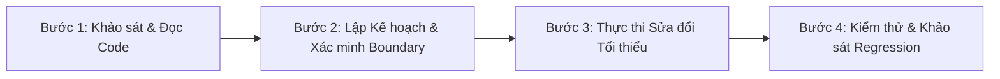

# LetStuN AI Agent Workflows & Multi-Skill Orchestration

> **Quy chuẩn điều phối dành cho AI Coding Agents (Antigravity, Gemini CLI, Claude Code)**  
> **Mục tiêu**: Đảm bảo các AI Agents làm việc nhất quán, an toàn, không phá vỡ logic đang hoạt động và tận dụng tối đa các Skills đã cài đặt.

---

## 1. Bản đồ Điều phối Kỹ năng (Skill Routing Matrix)

| Lĩnh vực nhiệm vụ | Kỹ năng được kích hoạt (Active Skill) | Nguồn cài đặt | Hướng dẫn áp dụng |
| :--- | :--- | :--- | :--- |
| **Code Review & Git Diff Audit** | `code-review-expert` | `.agents/skills/code-review-expert` | Kiểm tra vi phạm SOLID, rủi ro bảo mật, type safety và regression trên các tệp đã sửa |
| **Giao diện Di động & Touch Layout** | `sleek-design-mobile-apps` | `.agents/skills/sleek-design-mobile-apps` | Tối ưu hóa UI/UX cho màn hình nhỏ, touch target >= 44px, bottom sheet, gesture swipe flashcard |
| **Giải thích Giải thuật Phức tạp** | `sigma` | `.agents/skills/sigma` | Hướng dẫn học tập theo phương pháp Bloom's 2-Sigma khi người dùng cần giải thích thuật toán FSRS/SM-2 |
| **Tổng hợp Tài liệu & Tri thức** | `wiki-ingest` / `book-study` | `.agents/skills/wiki-ingest` | Khảo sát và biên soạn các tài liệu quy chuẩn, RFCs hoặc giáo trình từ vựng vào hệ thống tri thức |
| **Tối ưu React Rendering** | *Vercel React Best Practices* | Quy chuẩn nhúng trong `apps/web/AGENTS.md` | Kiểm soát re-render, hạn chế tạo object trong render loop, memoization, forwardRef |

---

## 2. Quy trình 4 Bước Bắt buộc cho Mọi Thay đổi Code (The 4-Step Discipline)

### Bước 1: Khảo sát & Đọc Code (Investigation First)
- **Tuyệt đối không đoán mò**: Luôn đọc file nguồn bằng `view_file` hoặc tìm kiếm bằng `grep_search` trước khi đề xuất sửa đổi.
- Kiểm tra `git status` để biết các thay đổi chưa commit của người dùng. Không được ghi đè hoặc rollback các thay đổi này.

### Bước 2: Lập Kế hoạch & Xác minh Boundary (Boundary Verification)
- Xác định xem tệp cần sửa thuộc về Frontend (`apps/web`), Backend (`apps/api`), hay Shared Package (`packages/shared`).
- Nếu sửa đổi API contract (DTOs, Endpoint response), phải kiểm tra và cập nhật đồng bộ cả Frontend và Backend.

### Bước 3: Thực thi Sửa đổi Tối thiểu (Minimal Viable Diff)
- Chỉ sửa đúng phạm vi được yêu cầu. Không tự ý format lại toàn bộ file hoặc refactor các đoạn mã không liên quan.
- Giữ nguyên các comments, docstrings và business logic hiện hữu.

### Bước 4: Kiểm thử & Khảo sát Regression (Verification Gate)
- Kích hoạt kỹ năng `code-review-expert` để kiểm tra diff vừa tạo.
- Chạy unit test liên quan để đảm bảo không phát sinh lỗi mới.
- Không tuyên bố hoàn thành nếu chưa có bằng chứng kiểm thử.

---

## 3. Các Hành vi Tuyệt đối Bị Cấm (Strict Invariants)

1. ❌ **Không commit hoặc log Secret**: Tuyệt đối không đưa các khóa bí mật (`JWT_ACCESS_SECRET`, `FIREBASE_API_KEY`, mật khẩu database, nội dung `.env`) vào log, git commit hay tài liệu.
2. ❌ **Không chạy migration phá hủy dữ liệu**: Cấm chạy các lệnh `prisma migrate reset` hoặc `DROP TABLE` trên database đang hoạt động.
3. ❌ **Không tạo file tài liệu rác**: Không tạo các file `.md` rỗng hoặc sao chép nội dung chung chung.
4. ❌ **Không giả lập kết quả**: Phải chạy lệnh thực tế và báo cáo trung thực kết quả thực thi (kể cả khi thất bại).
