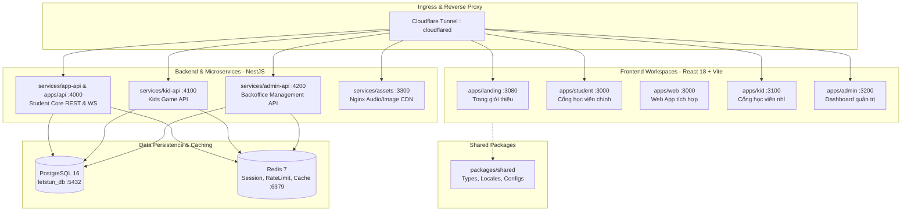

# LetStuN AI System Architecture

> **Trạng thái**: Đã xác minh từ mã nguồn và cấu hình Docker Compose (Verified)  
> **Phiên bản tài liệu**: 1.0.0 — Ngày lập: 15/10/2026  
> **Tác giả**: Staff Software Architect & Principal Security Reviewer

---

## 1. Tổng quan Kiến trúc Hệ thống (High-Level Architecture)

LetStuN AI là nền tảng học từ vựng tiếng Anh chuyên sâu tích hợp Spaced Repetition (Thuật toán lặp lại ngắt quãng SM-2/FSRS), Flashcard đa ngôn ngữ, hệ thống game học tập cho trẻ em (Kid Mode), và cổng quản trị (Admin Portal). 

Dự án được cấu trúc theo mô hình **Monorepo** quản lý bằng **npm workspaces**, gồm 5 ứng dụng giao diện (frontend), 1 backend API trung tâm (NestJS), 4 microservice đóng gói container và hạ tầng mạng Cloudflare Tunnel.

---

## 2. Phân tầng Ứng dụng & Công nghệ (Technology Stack Inventory)

### 2.1. Frontend Tier (`apps/*`)
- **Core Framework**: React 18.2.0, React DOM 18.2.0.
- **Build Tool & Dev Server**: Vite 5.1.6 (Rolldown/OXC & Babel plugins).
- **Styling**: Tailwind CSS 3.4.3, Autoprefixer, PostCSS.
- **Routing**: `react-router-dom` v6.22.3.
- **Visuals & 3D**: `three` (v0.186.0), `swiper` (v14.3.0), `lucide-react` (v0.364.0), `lenis` (v1.3.26 - Smooth scrolling).
- **Document & Media Parsing**: `pdfjs-dist` (v5.4.624), `mammoth` (v1.13.0 - Word parser), `xlsx` (v0.18.5), `google-tts-api` (v2.0.2).
- **Realtime**: `socket.io-client` (v4.7.5).
- **Cloud/Identity**: Firebase v12.18.0.

### 2.2. Backend API Tier (`apps/api` & `services/*-api`)
- **Core Framework**: NestJS 10.3.0 (Express engine), TypeScript 5.3.3.
- **Database ORM**: Prisma Client v5.14.0.
- **Authentication**: Passport.js (`passport-jwt` v4.0.1, `bcrypt` v5.1.1, `@nestjs/jwt` v10.2.0).
- **Validation**: `class-validator` v0.14.1, `class-transformer` v0.5.1.
- **Cache & Pub/Sub**: `ioredis` v6.0.0.
- **Realtime**: `@nestjs/websockets` v10.3.0, `@nestjs/platform-socket.io` v10.3.0.
- **Email & Notification**: `nodemailer` v6.10.1.
- **Speech Synthesis**: `msedge-tts` v2.0.7 (Microsoft Edge TTS engine).
- **Documentation**: Swagger UI (`@nestjs/swagger` v7.3.0) tại `/api/docs`.

### 2.3. Shared Package Tier (`packages/shared`)
- **Nhiệm vụ**: Cung cấp kiểu dữ liệu TypeScript dùng chung, cấu hình hệ thống ngôn ngữ (Language Definitions, CEFR Levels, Writing Scripts) và i18n locales.
- **Đường dẫn nhập khẩu**: `@letstun/shared` liên kết thông qua workspace protocol (`*`).

### 2.4. Infrastructure & Deployment
- **Docker Compose**: Orchestration toàn bộ 9 container dịch vụ nội bộ kết nối qua bridge network `letstun-network`.
- **Nginx Assets**: Dịch vụ phục vụ static files trực tiếp từ volume `./assets` với health check endpoint `/health`.
- **Cloudflare Tunnel (`cloudflared`)**: Proxy an toàn không mở port trực tiếp ra Internet công cộng, định tuyến tên miền `*.letstun.site`.

---

## 3. Ranh giới Phụ thuộc & Nguyên tắc Module (Boundary Rules)

1. **Frontend không truy cập trực tiếp Database**: Toàn bộ thao tác đọc/ghi phải đi qua REST API hoặc WebSocket Gateway của backend.
2. **Shared Package là Stateless**: `packages/shared` chỉ chứa pure types, interfaces, helpers không phụ thuộc runtime state hoặc database.
3. **Multi-Tenant / Split-API Invariant**:
   - `services/admin-api` sử dụng tiền tố Redis `admin:` và port nội bộ `4200`.
   - `services/app-api` sử dụng tiền tố Redis `app:` và port nội bộ `4000`.
   - `services/kid-api` sử dụng tiền tố Redis `kid:` và port nội bộ `4100`.
   Tất cả dùng chung database PostgreSQL `letstun_db` nhưng phân tách rõ ràng qua Role Guards và Session scopes.
