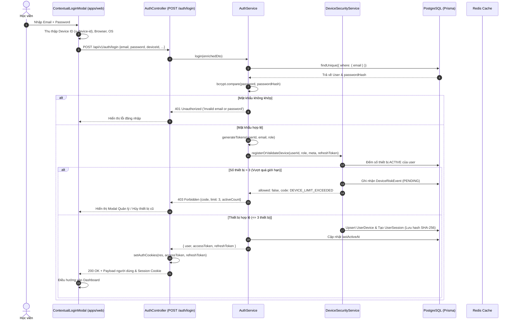
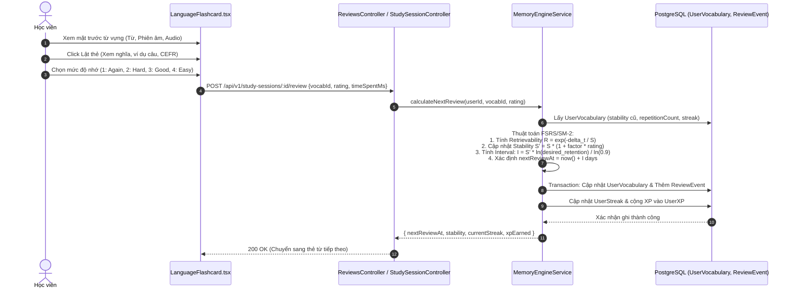

# LetStuN AI End-to-End Business Flows

> **Trạng thái**: Đã trace chi tiết từ UI Component đến Database Transaction (Verified)

---

## 1. Luồng 1: Đăng nhập & Xác thực Thiết bị (Authentication & Device Risk Flow)

---

## 2. Luồng 2: Phiên Học Flashcard & Cập nhật Trí nhớ (Spaced Repetition Review Flow)

---

## 3. Luồng 3: Trích xuất Từ vựng Thông minh (Vocabulary Capture Flow)

1. **Trigger**: Người dùng tải lên tệp tài liệu PDF, DOCX hoặc dán đoạn văn bản vào `VocabularyCaptureModal.tsx`.
2. **Parsing**:
   - Tệp DOCX được phân tích bởi `mammoth` tại trình duyệt hoặc backend.
   - Tệp PDF được phân tích bởi thư viện `pdfjs-dist`.
3. **API Call**: Gửi `POST /api/v1/vocabulary/capture` với danh sách từ vựng trích xuất.
4. **Backend Processing**: `MemoryEngineService` thực hiện chuẩn hóa từ (`normalizedWord`), truy vấn đối chiếu với từ điển `Vocabulary` trong database.
5. **Enrichment**: Lấy cấp độ CEFR, các quan hệ từ vựng (Synonym, Collocation, Example).
6. **Persistence**: Ghi vào bảng `VocabularyCapture` và liên kết `UserVocabulary` ở trạng thái ban đầu `NEW` / `LEARNING`.
